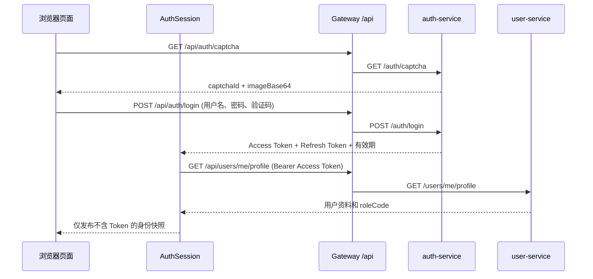

# 管理端功能与设计结构

## 1. 项目定位

`order_sys_admin` 是校园点餐微服务系统的运营管理端，基于 Vue 3 + TypeScript。当前交付范围是登录认证、角色入口保护、当前身份工作台外壳和注销；商品、档口、订单、用户管理等业务页面还没有实现，因此工作台明确提示后续接入，不伪造统计卡片或菜单。

前端只负责交互和导航。角色、餐厅/档口数据范围及具体操作权限，最终必须由 Gateway 后面的业务服务执行校验。

## 2. 当前功能

| 功能            | 当前行为                                                                          |
| --------------- | --------------------------------------------------------------------------------- |
| 登录            | 用户名、密码、图片验证码；提供密码显隐、字段提示、重复提交保护和服务端错误提示    |
| 身份确认        | 登录后调用本人资料接口，以服务端返回的角色作为身份事实来源                        |
| 允许的角色      | `STALL_MANAGER`、`RESTAURANT_MANAGER`、`GENERAL_MANAGER`、`SYSTEM_ADMIN`          |
| 登录恢复        | 页面刷新后从当前标签页会话中读取令牌，并向服务端重新确认资料                      |
| Token 续期      | 临近过期时提前刷新；多个同时到来的请求共享一次刷新；401 最多重放原请求一次        |
| 注销            | 带当前 Access Token 和 Refresh Token 请求后端撤销；服务端确认成功后才清理本地状态 |
| 工作台          | 显示当前账号和角色；业务模块按后续计划接入                                        |
| 无权限/未知地址 | 提供 403 与 404 页面及返回工作台入口                                              |

顾客角色不能进入管理端。即使前端路由拦截失效，接口仍应由后端鉴权和数据范围规则保护。

## 3. 目录职责

```text
src/
├── auth/
│   ├── contracts.ts   # API 响应、登录资料、验证码和本地会话类型
│   ├── errors.ts      # API 与认证错误类型
│   ├── http.ts        # JSON 请求、统一响应码解析、Bearer 请求头
│   ├── policy.ts      # 管理角色名单与角色展示名称
│   ├── runtime.ts     # 单例认证协调器及浏览器存储适配
│   ├── session.ts     # 登录、身份恢复、并发续期、注销
│   └── storage.ts     # sessionStorage 会话结构校验和清理
├── assets/
│   ├── tokens.css     # 唯一设计变量来源
│   ├── base.css       # 全局基础样式、焦点和减少动态偏好
│   └── main.css       # 登录、工作台、403/404 页面样式
├── router/index.ts    # 页面路由与角色门禁
├── stores/auth.ts     # Pinia 认证视图状态，不保存 JWT 字符串
├── views/
│   ├── LoginView.vue  # 登录与图片验证码
│   ├── HomeView.vue   # 当前身份工作台外壳
│   ├── ForbiddenView.vue
│   └── NotFoundView.vue
├── App.vue            # 顶层 RouterView
└── main.ts            # Vue、Pinia、Router 的应用装配

docs/
├── ADMIN_STRUCTURE.md
└── LOGIN_IMPLEMENTATION_PLAN.md
DESIGN.md              # 设计约定及视觉变量映射
```

## 4. 路由行为

| 前端路由     | 保护               | 行为                                                                |
| ------------ | ------------------ | ------------------------------------------------------------------- |
| `/login`     | 否                 | 已登录且已确认的管理角色进入 `/`；否则显示登录页                    |
| `/`          | 需要登录和管理角色 | 未登录转到 `/login?redirect=/...`；恢复身份后按角色决定是否允许进入 |
| `/forbidden` | 否                 | 当前账号无管理端权限时显示拒绝说明                                  |
| 其他地址     | 否                 | 显示 404 页面                                                       |

登录后的 `redirect` 只接受同源站内路径；跳转不会携带 Token。路由门禁只是用户体验保护，不代替服务端授权。

## 5. 登录与请求链路



认证协调器与 Pinia 状态分离：`AuthSession` 负责令牌和请求编排；Pinia 只暴露资料、是否已登录、忙碌状态和提示文本。视图不直接读写令牌。

### 接口映射

| 前端请求                    | Gateway 转发后的服务路径 | 用途                             |
| --------------------------- | ------------------------ | -------------------------------- |
| `GET /api/auth/captcha`     | `GET /auth/captcha`      | 获取一次性验证码                 |
| `POST /api/auth/login`      | `POST /auth/login`       | 用户名、密码、验证码登录         |
| `GET /api/users/me/profile` | `GET /users/me/profile`  | 查询本人资料和真实角色           |
| `POST /api/auth/refresh`    | `POST /auth/refresh`     | 用 Refresh Token 轮换双令牌      |
| `POST /api/auth/logout`     | `POST /auth/logout`      | 校验当前 Access Token 并撤销会话 |

前端类型与当前后端的 `ApiResponse`、`CaptchaVO`、`LoginVO`、`UserProfileVO` 对应。统一响应只有 HTTP 成功且业务码为 `COMMON_000` 时才作为成功处理。

## 6. 会话与安全边界

- Access Token 和 Refresh Token 同时保存在 `sessionStorage`，仅当前标签页会话可读；关闭标签页后浏览器清除。刷新页面仍可恢复，随后必须重新向服务端查询用户资料。
- 不使用 `localStorage`、Cookie 自行传 Token、URL 参数或 Pinia 持久化保存 JWT；密码只在提交期间保留于组件状态。
- 所有认证请求设置 `cache: no-store`；Bearer Token 只放在 `Authorization` 请求头。
- 并发刷新采用 single-flight；刷新后迟到的旧 Token 401 复用已保存的新 Access Token；业务请求只重放一次，避免无限循环。
- 注销请求失败时，不谎报退出成功；界面保留会话并显示错误，以便重试。
- `sessionStorage` 仍可能被同源脚本读取，不能抵御 XSS。更高安全等级部署可评估 BFF + HttpOnly Cookie，但本次保持与现有后端 JWT 协议一致。
- 前端角色判断只控制页面体验。用户身份、权限角色和 `restaurant_id` / `window_id` 数据范围都必须在服务端再次校验。

## 7. 设计约定

- 中文运营产品风格，桌面端双栏登录；窄屏使用单栏；表单字段和按钮保持触控尺寸。
- 深绿用于运营说明区，橙色用于品牌与主要操作；颜色、字体、圆角、间距统一读取 `src/assets/tokens.css`。
- 不使用远程字体或图片，不编造订单、销量、库存等数据；首期工作台只展示真实登录身份。
- 表单支持键盘焦点、密码显隐、加载、失败提示和验证码重取；遵循系统减少动态效果偏好。
- 设计细则见 [DESIGN.md](../DESIGN.md)。

## 8. 本机配置与运行

- 开发代理：浏览器请求同源 `/api`，Vite 将其转发至 `VITE_GATEWAY_URL`；默认 `http://127.0.0.1:9090`。
- 本机覆盖写入 `.env.local`，此文件由 `.gitignore` 排除；仓库只提交 `.env.example`，不提交访问凭据。
- 开发：`npm ci` 后运行 `npm run dev`。
- 类型检查和生产构建：`npm run build`（顺序执行 `vue-tsc --build` 与 `vite build`）。
- 部署：反向代理同源转发 `/api` 到 Gateway，并为 Vue Router history 路由配置 `index.html` 回退。

## 9. 暂不包含的内容

首期不包含注册、找回密码、角色/权限配置、商品/档口/订单/用户 CRUD、报表、审计日志、Nginx/容器部署和自动化登录测试。后续每增加业务页面，都需同步定义 API 契约、数据范围、加载/空/失败状态与对应角色权限，再接入此应用壳。
